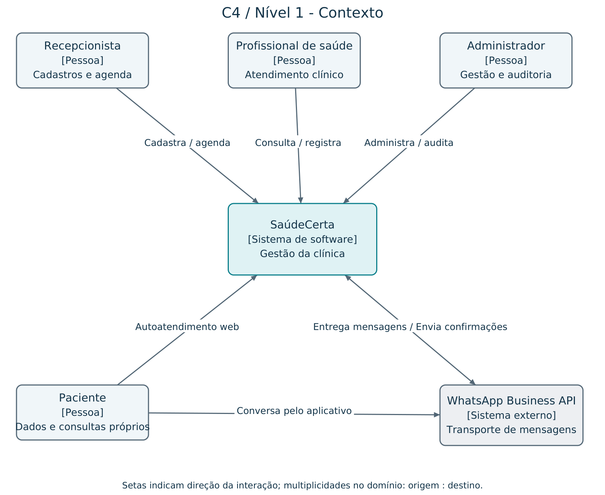
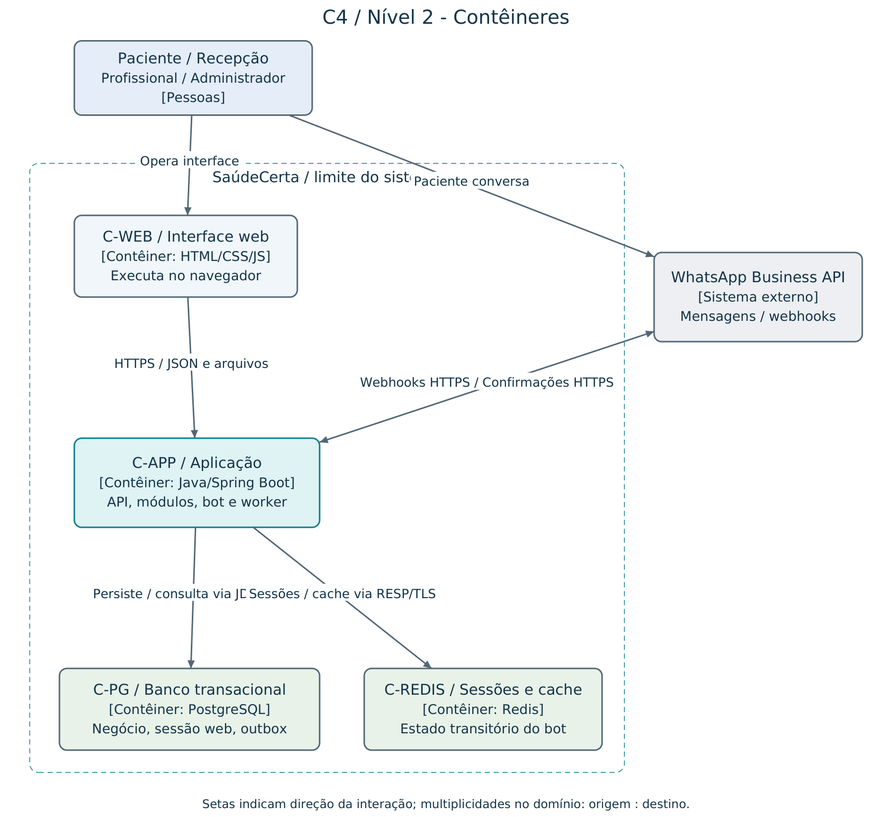
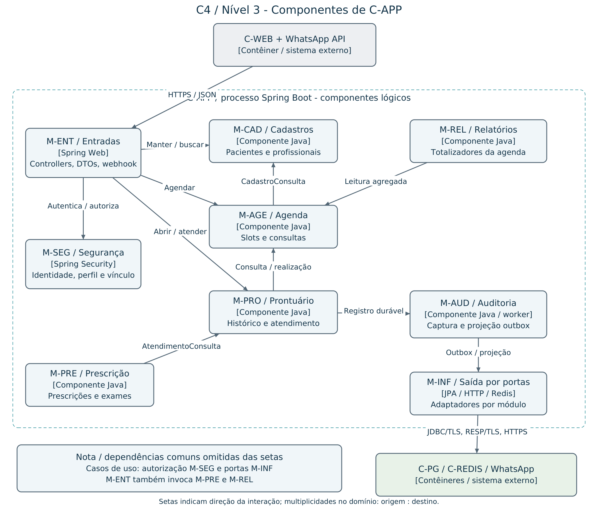

# E2 - Projeto arquitetural do SaúdeCerta

Core4 Tech | IFPA Campus Belém | TEADS0347 | C795NL | 2026.2

**Autores:** Laura Alves, Gabriel Prado Brandão, Adinayane Souza e Ruan William Leão. **Docente:** Márcio Goes do Nascimento. **Data:** 04/11/2026. **Estado:** projeto proposto para E2, sujeito à revisão da equipe e à validação na E3/PF.

## 1. Base, escopo e estado atual

A arquitetura refina a E1, as atividades das Aulas 2 e 3 e o guia oficial. Os RF01-RF13, RN01-RN07 e RNF01-RNF07 conservam seus significados. RF-E01 (WhatsApp), RNF-E01/E02 e RN-E01/E02 são complementos da equipe. Consulte [requisitos](requisitos.md) e [fontes](referencias.md).

A clínica tem cerca de vinte profissionais. O núcleo cobre cadastros, agenda, prontuário, prescrições/exames, segurança/auditoria e relatórios. Faturamento, convênios, laudos externos, telemedicina e assinatura ICP-Brasil ficam fora do escopo inicial. O WhatsApp é um canal complementar, sem acesso ao conteúdo clínico.

O código inspecionado contém DemoApplication, configuração e teste inicial. O pom.xml declara Java 17, Spring Boot 4.1.0, Web MVC, JPA, validação e H2. O guia sugere Boot 3.x; a compatibilidade do build e a versão a usar na E3 precisam ser verificadas. A E2 não altera o pom nem afirma que PostgreSQL, Redis, segurança ou casos de uso já estejam implementados. Diagramas representam a arquitetura alvo, não o estado executável atual.

## 2. Visões C4

Fonte editável com quatro abas: [arquitetura.drawio](arquitetura.drawio). Exportações em PNG usam os mesmos elementos, posições e relações da fonte. A quarta aba é o modelo de domínio, não um nível adicional do C4.

### C4 nível 1 - Contexto

O limite é o sistema SaúdeCerta inteiro. Recepção opera cadastros e agenda; profissional consulta e registra conteúdo clínico autorizado; paciente consulta os próprios dados; administrador gerencia usuários, indicadores e auditoria. WhatsApp Business API é o único sistema externo do escopo atual. Banco de dados e Redis aparecem apenas no nível de contêineres.

### C4 nível 2 - Contêineres

**C-WEB:** interface HTML/CSS/JavaScript no navegador, servida como arquivos estáticos pelo próprio Spring Boot, decisão proposta para evitar outro deploy inicial. **C-APP:** Java/Spring Boot, API REST, módulos de negócio, webhook e trabalhadores internos. **C-PG:** PostgreSQL, fonte de verdade transacional e persistência de auditoria/outbox. **C-REDIS:** Redis, sessão transitória e cache de horários. Esses três serviços de servidor são unidades de execução distintas, mas só C-APP contém a aplicação de negócio.

Comunicação web por HTTPS/JSON; aplicação com PostgreSQL por JDBC/TLS e Redis por RESP/TLS em rede privada; webhook recebido e mensagens enviadas por HTTPS à API externa. Não existe acesso direto do navegador ou do provedor aos bancos. O paciente também pode usar a interface web. A interface é um contêiner de execução no navegador, embora seus arquivos compartilhem o pacote de implantação do backend.

### C4 nível 3 - Componentes de C-APP

O zoom abre apenas C-APP. São componentes lógicos do mesmo processo: M-ENT (controllers/DTOs e webhook), M-SEG (autenticação e políticas), M-CAD (Cadastros), M-AGE (Agenda), M-PRO (Prontuário), M-PRE (Prescrição/Exames), M-AUD (Auditoria/outbox), M-REL (Relatórios) e M-INF (adaptadores de saída). O diagrama mostra os fluxos principais e agrupa portas e adaptadores para legibilidade. As dependências comuns indicadas na nota se aplicam a todos os casos de uso; a tabela de contratos abaixo explicita as demais chamadas, inclusive entradas de prescrição e relatórios. Chamadas internas são síncronas Java; consumo da outbox é assíncrono, porém ocorre dentro do mesmo processo nesta etapa.

## 3. Camadas e componentes

| Camada | Responsabilidade | Dependências permitidas |
|---|---|---|
| api / entrada | HTTP, DTOs, validação sintática e tradução de erros | application e contratos de autenticação; nunca repositório direto |
| application | Casos de uso, autorização contextual, transação e composição | domain e portas públicas dos outros módulos |
| domain | Entidades, invariantes e interfaces de repositório | Tipos de domínio; sem Spring, JPA, HTTP ou Redis |
| infra / saída | Mapeamento JPA, SQL, Redis, HTTP externo e tarefas | Implementa portas; depende dos contratos internos |
| transversal | Identidade, auditoria, erros e telemetria | Aplicado nas entradas e nos casos de uso, sem substituir invariantes |

Organização proposta: br.edu.ifpa.saudecerta.{cadastro,agenda,prontuario,prescricao,seguranca,auditoria,relatorios}, cada módulo com api/application/domain/infra. integracao.whatsapp contém entrada e saída de mensagens. shared limita-se a tipos técnicos mínimos. Esse pacote é alvo da E3; não renomeia o esqueleto atual nesta entrega.

| ID e componente | Contratos e responsabilidade | Dados próprios / dependências |
|---|---|---|
| M-ENT - entradas | PacienteController, ConsultaController, ProntuarioController, WebhookController; DTOs mínimos | Chama M-SEG e casos de uso de M-CAD/M-AGE/M-PRO/M-PRE/M-REL; não acessa SQL |
| M-SEG - segurança | Autenticar, AutorizarAcao(usuario, recurso), resolver identidade | Usuario e perfil; vinculação a paciente/profissional; RegistroAuditoria para negativas |
| M-CAD - cadastros | ManterPaciente, ManterProfissional, ConsultarPaciente; porta CadastroConsulta | Paciente, Profissional, Especialidade; RepositorioCadastro |
| M-AGE - agenda | DefinirDisponibilidade, Marcar, Remarcar, Cancelar; porta ConsultaLeitura | Disponibilidade e Consulta; CadastroConsulta, RepositorioConsulta, Relogio e Outbox |
| M-PRO - prontuário | AbrirHistorico, RegistrarAtendimento, AnexarComplemento; porta AtendimentoConsulta | Prontuario, Atendimento, Complemento; ConsultaLeitura, RegistrarRealizacao e RegistroAuditoria |
| M-PRE - prescrição/exames | EmitirPrescricao, SolicitarExame, RegistrarStatusExame | Prescricao, ItemPrescricao, SolicitacaoExame; AtendimentoConsulta e RegistroAuditoria |
| M-AUD - auditoria | RegistrarEventoDuravel, ProjetarAuditoria, ConsultarTrilha | EventoOutbox e RegistroAuditoria; projeção idempotente por eventoId |
| M-REL - relatórios | TotalizarConsultas(periodo, profissional, especialidade) | Porta de leitura agregada da Agenda; DTO sem queixa/evolução |
| M-INF - adaptadores | Repositórios JPA/SQL por módulo, RedisSessionStore, WhatsAppGateway | PostgreSQL/Redis/API externa; implementam portas e não criam regras paralelas |

Chamadas entre módulos usam IDs e DTOs imutáveis, nunca entidades JPA ou repositórios alheios. M-PRO coordena a criação do atendimento e chama RegistrarRealizacao de M-AGE na mesma transação local. M-AGE não importa M-PRO. M-PRE verifica existência/autorização pela porta de M-PRO. M-REL utiliza a consulta pública da Agenda. Outbox desacopla notificações e projeção de auditoria; futuros consumidores recebem evento versionado AtendimentoRegistrado, sem conteúdo clínico.

## 4. Fluxos e consistência

### UC01 - Marcar, remarcar ou cancelar

1. A entrada autentica a sessão ou identifica a vinculação verificada do canal; o caso de uso autoriza o ator e valida o DTO.
2. Agenda consulta Cadastros, confere disponibilidade, relógio da clínica e RN-E02. Horários exibidos no cache são apenas sugestões.
3. Uma transação grava a consulta AGENDADA, protegida por unicidade parcial (profissionalId, dataHora) para status AGENDADA. Cada horário é um slot discreto; duração variável e sobreposição de intervalos exigirão nova decisão antes de serem suportadas.
4. A mesma transação registra a chave de idempotência e a notificação pendente na outbox. A resposta de sucesso ocorre após commit. Violação de unicidade vira conflito HTTP 409, não erro genérico.
5. Remarcação bloqueia a consulta original, verifica seu status e altera o horário atomicamente. Se o destino estiver ocupado, rollback preserva o horário anterior. Cancelamento também bloqueia e exige AGENDADA (RN07).

A geração de slots e a alteração de disponibilidade bloqueiam a mesma disponibilidade do profissional/dia; alterações que invalidem consultas existentes são rejeitadas. A unicidade de horário não substitui essa validação. Usar data/hora persistida como instante e converter pela zona America/Belem para as regras da clínica; testes incluem mudança de dia.

### UC02 - Abrir prontuário e atender

1. M-SEG confere perfil e vínculo ao recurso antes de buscar conteúdo clínico. Profissional atende consulta atribuída a ele; acesso clínico fora desse vínculo depende de concessão explícita, auditada e ainda a definir pela clínica.
2. A tentativa autorizada ou negada gera evento durável com eventoId, usuarioId, pacienteId, instante, ação, resultado e correlationId. A leitura só libera o DTO após commit desse evento. Se não puder registrar, nega a liberação e emite alerta operacional sem dados clínicos.
3. Registro do atendimento exige consulta do dia ou anterior (RN03), AGENDADA e ainda sem atendimento. A transação bloqueia a consulta, insere atendimento, marca REALIZADA e grava a outbox. Falha em qualquer passo reverte tudo.
4. Correções criam complementos com autor, instante e referência ao registro original. Nenhum endpoint oferece edição destrutiva/exclusão de atendimento. A conta da aplicação não recebe UPDATE/DELETE nas tabelas clínicas imutáveis.
5. Prescrições têm ao menos um item; exames e prescrições exigem atendimento existente (RN04). Mudanças de status de exame são novos eventos, preservando o histórico. Worker projeta auditoria com unicidade por eventoId e retentativas, monitorando atraso para RNF02.

### Canal WhatsApp

Validação de assinatura, limites de requisição e deduplicação por messageId precedem processamento. CPF ou nome da mãe não autenticam o usuário. Proposta: vincular o canal a uma conta autenticada pela web, por token de uso único com expiração e confirmação; a recepção oferece alternativa assistida. Sem vínculo, o bot apresenta informações gerais, sem revelar dados pessoais nem confirmar consultas de terceiros. Essa política precisa de validação de experiência com a clínica.

Sessão Redis com TTL proposto de 30 minutos; nunca guardar prontuário, senha ou token de acesso permanente. Cache de slots com TTL proposto de 30 segundos, invalidado após commit; erro de invalidação é tolerado porque a gravação sempre verifica PostgreSQL. Redis indisponível reinicia o fluxo do bot ou orienta a recepção; agenda web continua. A outbox permite reenviar confirmações após falha do provedor, sem duplicar consultas; entrega de mensagem pode se repetir se o provedor não oferecer idempotência, limitação assumida.

## 5. Segurança e operação

| Perfil | Permissão de projeto |
|---|---|
| Recepção | Dados cadastrais mínimos e agenda; nenhum conteúdo clínico |
| Profissional | Própria agenda e prontuários autorizados por vínculo; registra atendimento/prescrição/exame |
| Paciente | Dados e consultas próprios; exposição clínica no portal depende de política validada, nunca por WhatsApp |
| Administrador | Usuários, especialidades, relatórios e trilha; perfil administrativo não concede leitura clínica |

Sessão web opaca em cookie Secure/HttpOnly/SameSite, expiração por inatividade e proteção CSRF; sessão inicial armazenada em C-PG, para não tornar Redis dependência do canal web. Hash com sal por BCrypt, custo calibrado em ambiente alvo; limites de login e logs sem credenciais. Toda autorização é verificada no servidor, inclusive para IDs manipulados. Segredos fora do Git, bancos em rede privada, TLS, backup cifrado e privilégio mínimo. Essas são táticas do projeto, não uma certificação de conformidade legal.

Disponibilidade proposta: healthcheck externo a cada minuto para listar e marcar consulta sintética, monitorando falhas e latência; métricas de pool, erros, atraso da outbox e uso do Redis. Unidade de aplicação reiniciável; imagem e configuração prontas em servidor secundário conforme Aula 2. Sem cluster ativo-ativo inicial. Banco primário ainda é ponto de falha: backups e restauração ensaiada são essenciais, e alta disponibilidade será reavaliada se os ensaios não cumprirem RNF04/RNF-E02.

Plano de recuperação proposto: detectar em até 2 min; diagnosticar/acionar responsável até 5 min; restaurar aplicação/banco e configurar rede até 25 min; executar smoke de consulta, agenda e auditoria até 30 min do início da falha. Backup diário completo com WAL contínuo em armazenamento separado; RPO alvo proposto de 5 min, sujeito à validação e distinto do RTO de 30 min. Medir restore com volume representativo antes de aceitar o plano. Perda de sessão Redis é tolerada, perda de consulta/auditoria além do RPO não. Testar também restauração de credenciais, chaves e permissões sem expor segredos.

## 6. Evolução e riscos

O Projeto Final exige extração de ao menos um serviço e auditoria assíncrona funcional. A candidata inicial é Agenda, pela porta pública e limites explícitos; a E2 ainda usa transação local. A extração exigirá substituir a transação Agenda/Prontuário por protocolo de consistência e revisar C4/ADRs. Não prometer extração sem trabalho nem manter a transação local entre bancos separados.

Riscos a validar: slots/duração com a clínica; vínculo de acesso clínico; experiência de vinculação WhatsApp; carga de referência; restore dentro de 30 min; esforço de extensão em 5 dias/equipe. A escolha de frontend e sessão web é proposta desta E2. O desempenho em milissegundos atribuído ao Redis na Aula 3 é benefício esperado, sem benchmark disponível.

Verificações da E3/PF estão na [matriz](rastreabilidade.md) e nos [cenários](cenarios-qualidade.md). Nenhuma meta de qualidade está comprovada apenas por estes diagramas.
