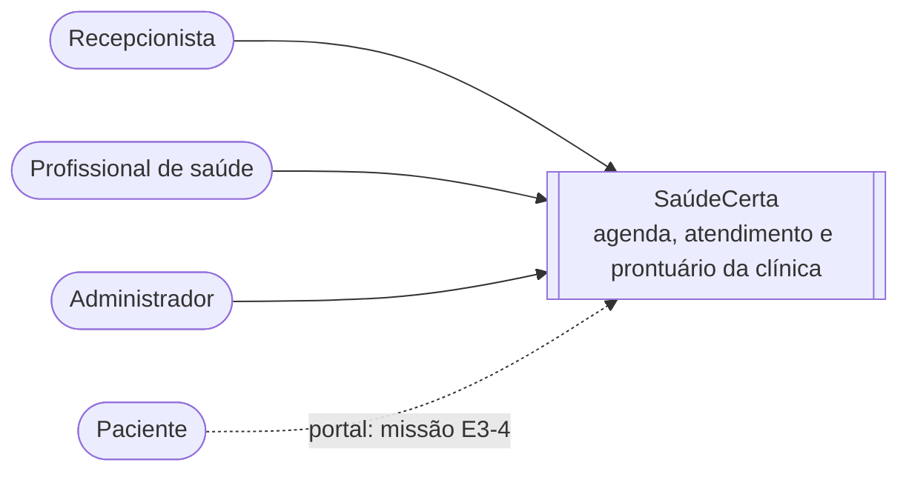
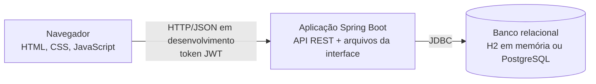
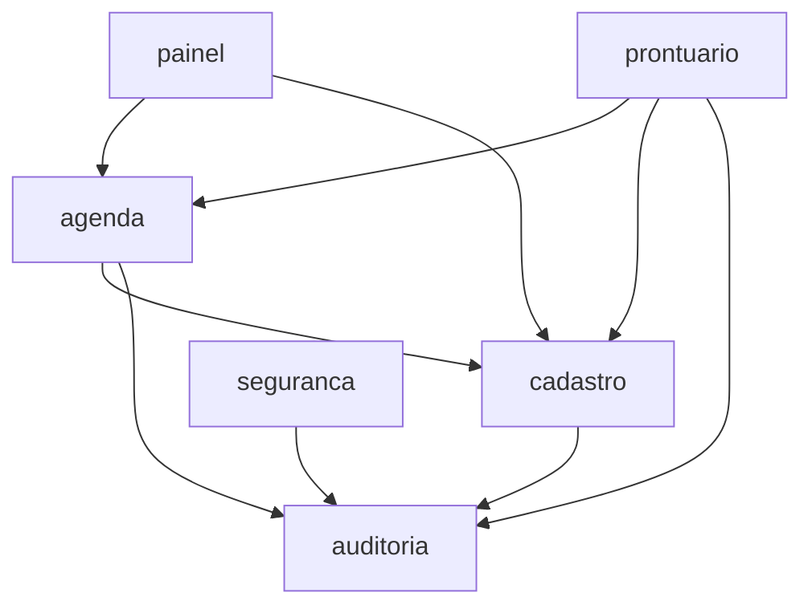
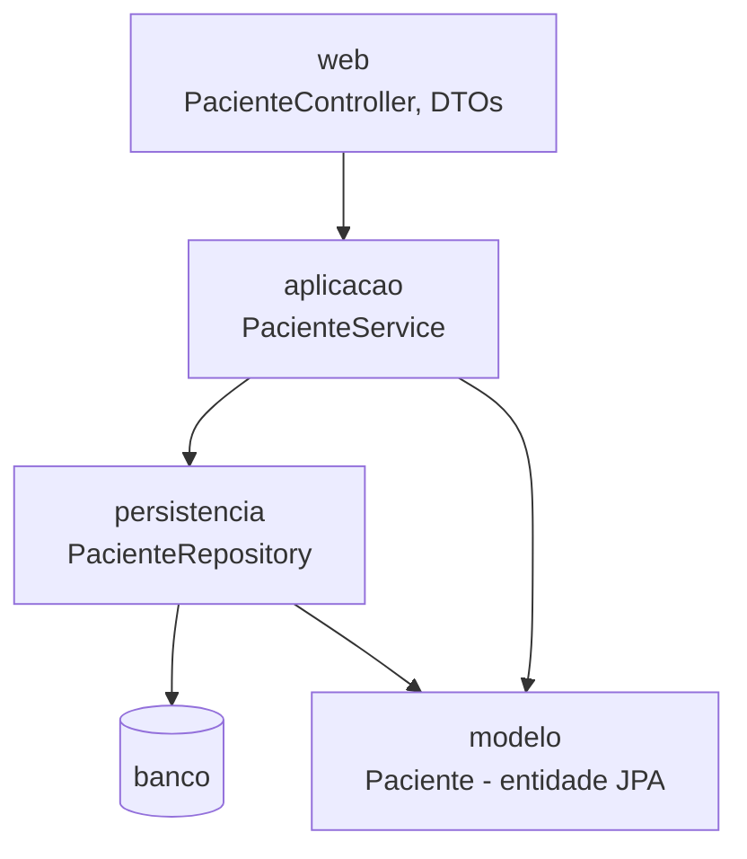
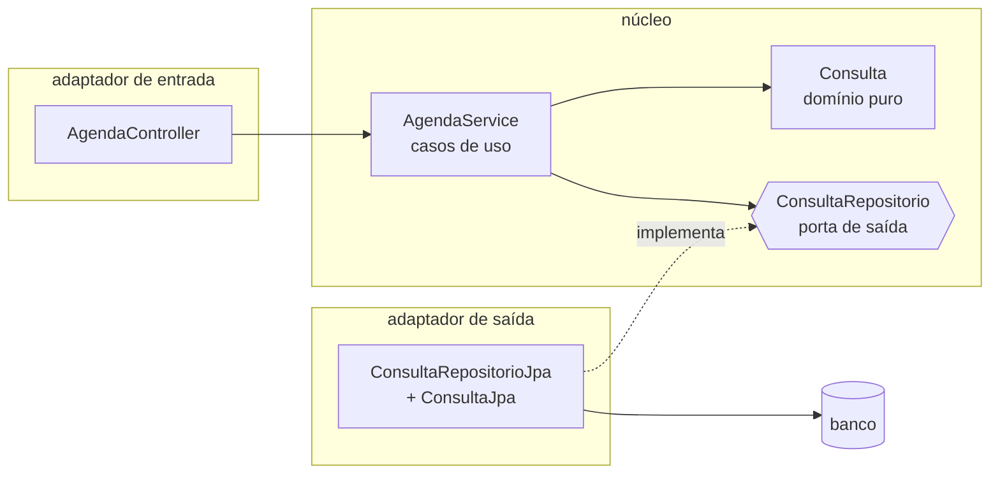

# Arquitetura do SaúdeCerta

Os diagramas usam Mermaid: o GitHub, o IntelliJ e o VS Code (com extensão) os desenham a partir do texto.

## Base e alcance desta versão consolidada

Revisão por inspeção do código em `src/`, do `pom.xml`, das configurações e dos testes existentes. Java 17 e Spring Boot 3.5.16 estão declarados no build. Os IDs de requisitos seguem [requisitos.md](requisitos.md); a cobertura e as lacunas estão na [matriz](rastreabilidade.md). Esta revisão documental não executou os testes nem comprovou metas de qualidade.

A arquitetura abaixo descreve a implementação atual. O projeto inicial da E2 permanece nos [diagramas editáveis](arquitetura.drawio), nas imagens de `diagramas/` e nas ADRs `adr-001` a `adr-006`: esses materiais são propostas históricas e não representam integralmente o código atual. As ADRs `0001` a `0006` descrevem as escolhas da implementação, incluindo JWT e auditoria síncrona. A numeração das duas séries não é intercambiável.

## 1. Contexto (C4 nível 1)

Não há sistemas externos nesta versão. Faturamento, laboratórios e telemedicina estão fora do escopo e são pontos de extensão.

## 2. Contêineres (C4 nível 2)

Um único processo serve a interface e a API. A interface é um cliente da API como qualquer outro: tudo o que ela faz pode ser feito pelo Swagger ou pelo arquivo `docs/api.http`.

## 3. Componentes: os módulos (C4 nível 3)

Regras do **monólito modular** (ADR 0001):

- cada pacote de primeiro nível é um módulo;
- um módulo de negócio só usa o pacote `api` do outro (`CadastroFachada`, `AgendaFachada`, `Auditoria`, `UsuarioLogado`);
- não há chave estrangeira JPA entre módulos — a agenda guarda `pacienteId`, não um `Paciente`;
- não há dependência circular.

O pacote `demo` é uma exceção explícita nos testes de acesso aos módulos, para criar dados de demonstração. O diagrama de componentes resume dependências de negócio; o uso dos contratos de identidade de `seguranca.api` e dos utilitários de `compartilhado` é transversal.

Essas regras existem para que um módulo possa virar serviço sem reescrever os outros (missão PF-1).

## 4. Dentro de um módulo: dois estilos

### Camadas (módulo `cadastro`)

A entidade JPA é o próprio modelo. Simples e suficiente para cadastro.

### Hexagonal (módulos `agenda` e `prontuario`)

As setas de dependência apontam para dentro. `Consulta` não importa Spring nem JPA, o que permite testar suas regras sem iniciar Spring ou banco. O custo é o mapeamento `Consulta ⇄ ConsultaJpa`. A comparação entre os dois estilos está na ADR 0002.

## 5. Transversais

| Preocupação | Solução | Onde |
|---|---|---|
| Autenticação | token JWT assinado (HS256), sem sessão no servidor | `seguranca`, ADR 0005 |
| Autorização | perfis (RBAC) por rota + regra de "profissional responsável" no domínio | `SecurityConfig`, `Atendimento`, ADR 0004 |
| Auditoria | registro síncrono em transação própria | `auditoria`, ADR 0003 |
| Erros | Problem Details (RFC 9457) em um único ponto | `TratadorDeErros` |
| Tempo | `Clock` injetado | `RelogioConfig` |
| Observação das camadas | AOP + filtro HTTP | `compartilhado.raiox`, `docs/raio-x.md` |

## 6. Como a arquitetura é protegida

`ArquiteturaTest` (ArchUnit) transforma as regras acima em testes. Importar a classe errada quebra o build e a mensagem diz qual regra e em qual linha.

## 7. Fluxos, consistência e limites verificados

- **Agenda:** `AgendaService.agendar` valida cadastros ativos e usa `Consulta` para regras de horário e conflito de intervalos. A grade é fixa, de 30 minutos entre 07h e 19h; não há cadastro de disponibilidade individual. A criação rejeita domingos, mas `horariosLivres` não filtra domingos. A checagem seguida de gravação não impede corridas concorrentes (missão E3-5).
- **Atendimento:** a consulta passa por AGENDADA, CONFIRMADA, EM_ATENDIMENTO e REALIZADA. `ProntuarioService` coordena Agenda e Prontuário em transação local. Início e escrita exigem profissional responsável. A leitura de histórico exige perfil PROFISSIONAL na rota, mas não verifica vínculo clínico por paciente.
- **Auditoria:** `AuditoriaService.registrar` usa `REQUIRES_NEW`; a trilha pode sobreviver ao rollback do negócio. Não há outbox nem projeção assíncrona. As negativas de autorização não são todas registradas; não se deve afirmar cobertura integral de RNF01.
- **Regras divergentes:** o início do atendimento não verifica se a consulta é de hoje ou anterior (RN03); o cancelamento aceita também CONFIRMADA (diverge de RN07); registros abertos são sobrescritos e apenas os finalizados ficam imutáveis, sem mecanismo de complementos (RN05).
- **Tempo e operação:** usa-se `LocalDateTime` e `Clock.systemDefaultZone()`, sem fixar America/Belem. H2 em memória é o padrão; há perfil PostgreSQL e Docker Compose. TLS, alta disponibilidade, backup e restauração não ficam comprovados pela existência desse perfil.

## 8. Evolução preservada do projeto E2

O escopo alvo inclui prescrições, exames, relatórios e acesso do paciente; faturamento, convênios, laudos externos e telemedicina continuam fora do escopo inicial. Remarcação, prescrição, relatórios e portal são missões pendentes; a presença de rota protegida ou classe esqueleto não significa implementação concluída.

WhatsApp e Redis permanecem propostas de extensão (RF-E01), ausentes da implementação atual. Se retomados: validar assinatura e deduplicar webhooks; vincular o canal a uma identidade autenticada; não usar CPF/nome da mãe como autenticação; manter dados clínicos fora do bot e do cache; confirmar agendamentos somente após persistência. Cache de horários nunca substitui a validação transacional.

São critérios úteis preservados da E2, ainda a implementar ou validar: proteção concorrente no banco; remarcação atômica; histórico por complementos; auditoria de negativas; testes de carga e de recuperação. O plano proposto de recuperação em até 30 minutos e RPO de 5 minutos exige ensaios e validação; o RPO não é requisito oficial comprovado. As metas mensuráveis permanecem nos [cenários de qualidade](cenarios-qualidade.md).

A extração de um serviço e a auditoria assíncrona são evoluções do Projeto Final. Extrair Agenda exigirá rever a transação local Agenda/Prontuário e definir consistência entre processos. Outbox, retentativas e consumidores idempotentes são alternativas de projeto, não garantias já fornecidas pelo código.
