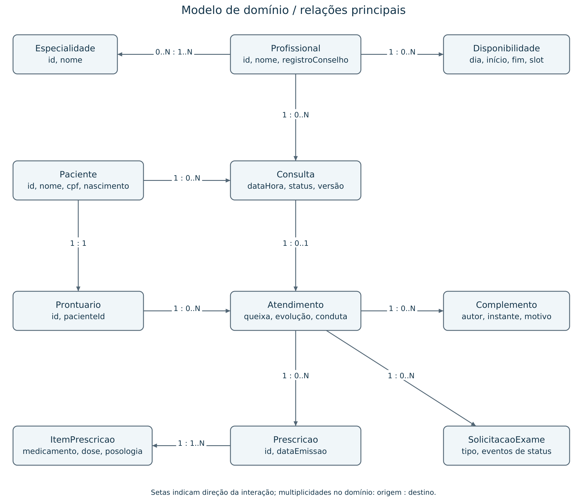

# Modelo de domínio

Base: guia, seções 7 e 10; E1, pp. 4-7. Modelo conceitual alvo; detalhes físicos serão definidos nas migrações da E3. Fonte editável na aba Domínio de [arquitetura.drawio](arquitetura.drawio).

## Entidades, atributos e cardinalidades

| Entidade / módulo | Atributos essenciais | Relacionamentos e restrições |
|---|---|---|
| Paciente / Cadastro | id, nome, cpf, nascimento, telefone, email, ativo | 1 para 0..N Consultas e 1 para 1 Prontuario; CPF único entre ativos (RN01) |
| Profissional / Cadastro | id, nome, registroConselho, ativo | 1 para 0..N Disponibilidades/Consultas; 1..N Especialidades por profissional |
| Especialidade / Cadastro | id, nome | 0..N Profissionais; associação muitos-para-muitos |
| Disponibilidade / Agenda | id, profissionalId, diaSemana, inicio, fim, duracaoSlot | Cada faixa pertence a um profissional; slots sem sobreposição por dia |
| Consulta / Agenda | id, pacienteId, profissionalId, especialidadeId, dataHora, status, versao | 1 paciente, 1 profissional, 1 especialidade válida; 0..1 Atendimento |
| Prontuario / Prontuário | id, pacienteId | Um por paciente; 0..N Atendimentos |
| Atendimento / Prontuário | id, consultaId, prontuarioId, autorId, instante, queixa, evolucao, conduta | Uma consulta única; paciente da consulta igual ao do prontuário; 0..N complementos/prescrições/exames |
| Complemento / Prontuário | id, atendimentoId, autorId, instante, texto, motivo | Anexa correção; mantém original (RN05) |
| Prescricao / Prescrição | id, atendimentoId, autorId, dataEmissao | Exatamente um atendimento e 1..N ItensPrescricao (RN04) |
| ItemPrescricao / Prescrição | id, medicamento, dose, posologia | Um único pai Prescricao |
| SolicitacaoExame / Prescrição | id, atendimentoId, tipoExame | 1 atendimento; 1..N eventos de status, começando SOLICITADO |
| EventoStatusExame / Prescrição | id, exameId, status, autorId, instante | Histórico anexado; último evento define status atual |
| Usuario / Segurança | id, login, senhaHash, perfil, ativo, pacienteId?, profissionalId? | Vínculos opcionais únicos; perfil paciente exige pacienteId; profissional exige profissionalId |
| RegistroAuditoria / Auditoria | eventoId, usuarioId, pacienteId, instante, acao, resultado, correlationId | Referencia paciente/ator sem copiar conteúdo clínico; append-only |
| EventoOutbox / Auditoria | id, tipo, versao, payloadMinimo, criadoEm, processadoEm, tentativas | Persistência durável; consumo idempotente; sem texto clínico |

Especialidade da consulta é registrada para relatórios históricos, mesmo que o profissional possua várias. Desativar cadastro não apaga consultas/prontuário. Usuario não é sinônimo de Paciente: cadastro assistido não cria automaticamente uma credencial.

## Agregados e invariantes

Paciente, Profissional, Disponibilidade e Consulta são raízes separadas. Prontuario organiza o histórico por paciente; Atendimento é raiz de escrita com seus Complementos, evitando carregar todo o histórico para anexar uma evolução. Prescricao agrega itens; SolicitacaoExame agrega eventos de status. IDs entre agregados evitam acoplamento e cascatas de exclusão. Relações clínicas usam chaves estrangeiras sem cascade delete.

Consulta começa AGENDADA. As transições permitidas são AGENDADA -> CANCELADA e AGENDADA -> REALIZADA (ao registrar atendimento). Remarcar mantém AGENDADA e troca dataHora atomicamente. Não há reabertura ou remoção nesta etapa. Cancelar REALIZADA/CANCELADA é rejeitado. Uma consulta admite no máximo um atendimento; a data local deve ser hoje ou anterior. RN-E02 impede nova marcação no passado, sem impedir registrar atendimento passado (RN03).

RN02 será defendida por regra do domínio e índice único parcial de profissional/dataHora quando AGENDADA. RN01 usa CPF normalizado e unicidade parcial entre ativos. RN04 usa vínculo obrigatório por FK; RN05 usa inserção de complementos e permissões restritas. O SQL definitivo é trabalho da E3; testar concorrência em PostgreSQL real, pois H2 não comprova suas restrições específicas.

RN-E01 permanece auxiliar e a validar; nome da mãe não é credencial. RN06 combina perfil com propriedade do recurso. Invariantes são comuns aos canais web e WhatsApp.
